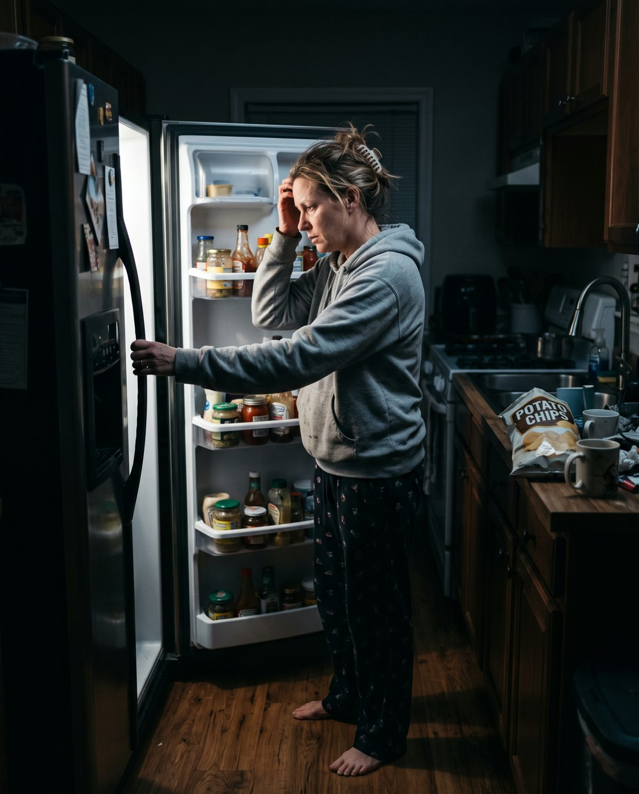
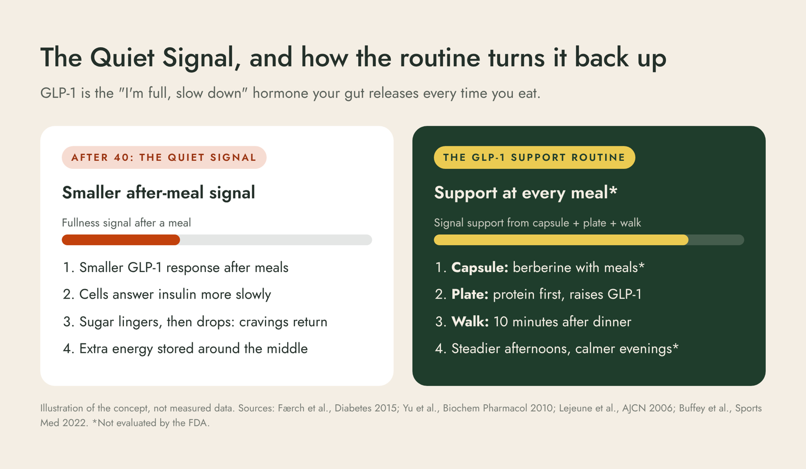
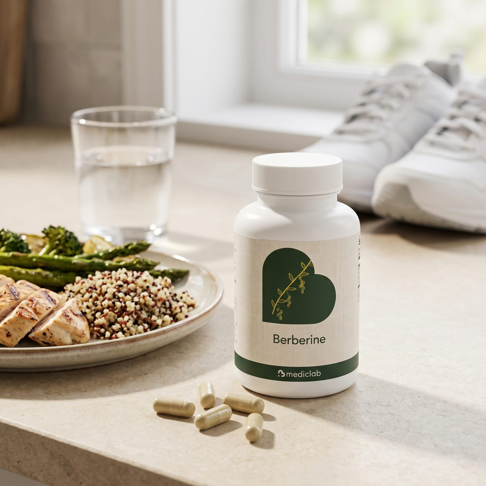
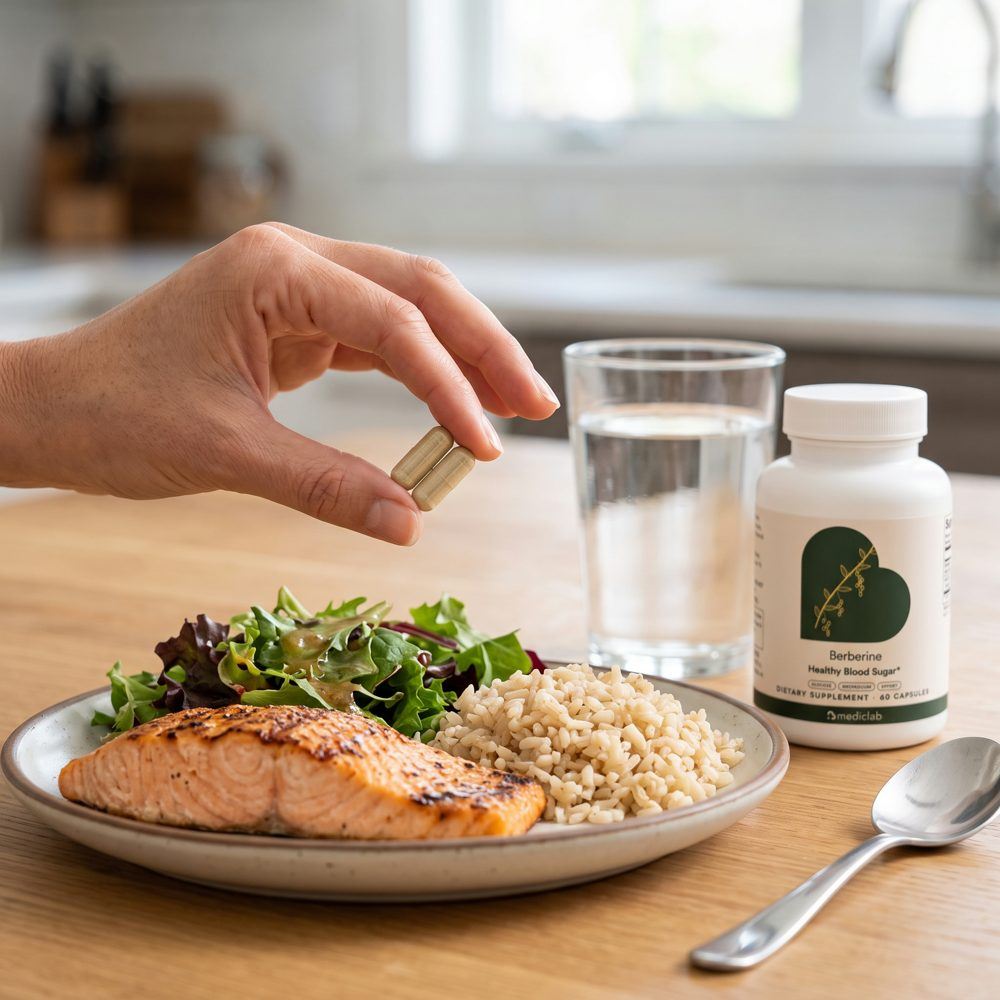

# Strategy
<!-- Built on the full berberine persona (389 verified competitor reviews) plus the weight-segment addendum (persona-weight-segment.md). -->

- **Big idea:** after 40, the stubborn weight is not a willpower problem. Your fullness signal got quieter. The fix is a daily routine that works with your body's own GLP-1, built around your meals.
- **Awareness:** 3 to 4. She knows berberine and GLP-1, and has tried diets.
- **Sophistication:** 5. "Nature's Ozempic" hype everywhere. We win with a named mechanism, a routine, printed math and the strongest guarantee.
- **Problem mechanism:** The Quiet Signal.
  - The after-meal GLP-1 fullness response is smaller in many adults carrying extra weight (Færch et al., Diabetes, 2015).
  - Cells answer insulin more slowly with age, less muscle and more sitting.
  - The result is swings, cravings and storage around the middle.
- **Solution mechanism:** The 3-Step GLP-1 Support Routine.
  1. Capsule: berberine with meals. It is studied for the body's own GLP-1 release in laboratory research and for glucose metabolism in human trials.
  2. Plate: protein first. Protein-rich meals raise GLP-1 (Lejeune et al., AJCN, 2006).
  3. Walk: 10 minutes after dinner, which lowers after-meal glucose (Buffey et al., Sports Medicine, 2022).
- **Offer:**
  - Monthly plan: first bottle $20.97 (50% off), then $42.97 every 30 days, with a 3-month minimum for the 50% discount, then cancel any time.
  - One bottle: $52.97.
  - Free US shipping on every order and refill.
- **Guarantee:** 60-day empty-bottle guarantee on the first order. Email within 60 days of delivery for a refund, even if the bottle is empty, and send nothing back.
- **Proof inventory:**
  - Ingredient research: berberine and GLP-1 (Yu 2010, lab and animal); berberine and weight, BMI and waist (Asbaghi 2020, 12 RCTs, at higher daily amounts).
  - Walking after meals (Buffey 2022) and protein and GLP-1 (Lejeune 2006).
  - Made in the USA in an FDA-registered, GMP facility.
  - No product trial and no customer reviews yet, so reviews are shown as labelled examples until real ones arrive.
  - The clinician photo is a model, disclosed on the page.
- **Top objections:** hype, stomach, dose, "will I lose weight", medicines, price and subscription, long-term use.
- **Hard lines:**
  - Never call the capsule "a GLP-1", never compare it to a drug, never promise pounds or timeframes.
  - No fake urgency or scarcity.
  - Reviews are labelled examples; the doctor image is disclosed as a model.

## 01 · Hero Image or GIF

[TRUST: No needle, no prescription; 2 capsules a day with meals; 60-day empty-bottle guarantee; Free US shipping]

## 02 · Headline
### Natural GLP-1 Support for Adults 40+ Done Fighting Stubborn Weight
Two capsules with meals, protein first, a 10-minute walk after dinner. The daily routine that works with your body's own GLP-1 to support healthy metabolism, steadier blood sugar and your weight-loss plan.* No needle. No prescription.

## 03 · Summary
After 40, the weight that used to come off stays on, because your body's "I'm full" signal gets quieter and your cells answer insulin more slowly. We call it the Quiet Signal. MedicLab Berberine is the core of a 3-step routine built around your meals: berberine with lunch and dinner, protein first, a short walk after eating. It supports healthy glucose metabolism and gives your weight-loss plan a daily system instead of willpower.*

## 04 · Key Benefits with Guarantee
- **Works with your body's own GLP-1** with berberine, protein and movement around every meal*
- **Supports steadier blood sugar** so afternoons run on energy, not pastries*
- **Supports healthy metabolism** as the daily backbone of your weight-loss plan*
- **Gentle by design**, taken with meals, never on an empty stomach
- **Every amount printed**: 800 mg berberine extract per serving, both strengths on the label
- **Under $0.70 a day** for your first month, with free shipping
[GUARANTEE: 60-day empty-bottle guarantee. Not for you? Email us and we refund your first order, even if the bottle is empty.]

## 05 · Call to Action with Offer
### Start your GLP-1 Support Routine today
[OFFER: Monthly GLP-1 Support Plan, first bottle 50% off | $20.97 | $42.97 | Then $42.97 every 30 days · free shipping · reminder 3 days before every refill · 3-month minimum, then cancel any time | Best value]
[OFFER: One bottle, one-time | $52.97 | | 60 capsules, 30 days · free shipping · no plan | ]
[CTA: Start My GLP-1 Support Plan, 50% Off]
Secure checkout · Free US shipping · 60-day empty-bottle guarantee · Ships from the USA in 1 to 3 days

## 06 · State the Problem Clearly
### You're doing everything "right." The scale isn't listening.

It's 9:30 at night. You ate a good dinner. And you're standing at the fridge again, not even hungry, just *thinking about food*.

At 3 pm the crash hits, and the vending machine wins.

You've done keto. Twice. You've counted every calorie in an app. You tried a "fat burner" that made your heart race. The weight came off for three weeks, then came back with friends, and it settled right around your middle.

Meanwhile, a friend started an injection and the weight is melting off her. You looked at the price, the needles, the side effects, and thought: *there has to be something my body can do on its own.*

> "I have tried so many diets, so many pills over the last 20+ years." (a berberine buyer, 5 stars)

Here's the truth: it is not your willpower. After 40, your body quietly changed the rules.

## 07 · Explain the Problem Mechanism
### The real reason the weight won't move: the Quiet Signal
Every time you eat, your gut releases a hormone called GLP-1. It is your body's own "I'm full, slow down, store less" signal. It tells your brain you've had enough and helps insulin move sugar out of your blood after a meal.

Here's what changes. Research shows the after-meal GLP-1 response tends to be **smaller in adults carrying extra weight** (Færch et al., *Diabetes*, 2015). At the same time, with age, less muscle and long hours of sitting, your cells answer insulin more slowly.

So the signal gets quieter. Sugar from a meal lingers, then drops. You feel hungry again too soon. Cravings get louder at night, and the extra energy gets stored, mostly around the middle.

That's why the diet that worked at 32 stops working at 45. You're not broken. **Your signal is quiet.**

## 08 · Detail the Solution Mechanism
### Turn the volume back up: the 3-Step GLP-1 Support Routine
We built MedicLab Berberine as the core of a routine that works *with* your body's own GLP-1 at the three moments that matter most: every meal.

1. **The Capsule.** Two berberine capsules a day with your meals. In laboratory research, berberine increased the body's own GLP-1 release (Yu et al., *Biochemical Pharmacology*, 2010), and human trials study it for healthy glucose metabolism.*
2. **The Plate.** Protein first, then everything else. Protein-rich meals raise GLP-1 more than carb-heavy ones (Lejeune et al., *American Journal of Clinical Nutrition*, 2006), so you feel full on less.
3. **The Walk.** Ten easy minutes after dinner. Working muscle pulls sugar out of the blood without waiting for insulin. Light walking after sitting lowered after-meal blood sugar in seven trials (Buffey et al., *Sports Medicine*, 2022).

Capsule, plate, walk. Three small moves, every day, that give your quiet signal backup.*

## 09 · Clarify Why Other Solutions Fall Short
### Why the usual fixes keep failing you
| | MedicLab GLP-1 Support Routine | Crash diets & keto | "Fat burner" pills | Random berberine bottles |
|---|---|---|---|---|
| Works with your body's own fullness signal | Yes - capsule, plate and walk at every meal | No - fights hunger with willpower | No - stimulants and jitters | No - a pill with no plan |
| Easy on the stomach | Yes - taken with meals, start at one capsule | No - hard to sustain | No - racing heart | No - often taken on an empty stomach |
| Label you can check | Yes - every amount printed | Doesn't apply | No - proprietary blends | No - doses hard to verify |
| Built for months, not weeks | Yes - refills arrive before you run out | No - rebound in weeks | No - you stop when the jitters start | No - forgotten in the cabinet |
| Refund on an opened bottle | Yes - 60 days, even empty | Doesn't apply | Rarely | Rarely |

Diets fight your hunger. Stimulants fight your heart rate. A bottle with no plan sits in the cabinet. None of them gives your quiet signal what it needs: support at every meal, every day.

## 10 · Explain Why Your Solution is Effective
### Why this routine works when willpower doesn't
- **It's built around meals, the moment GLP-1 is released.** You don't need more discipline at 9:30 pm. You need a better signal at 6:30.*
- **It's gentle, so you actually keep taking it.** The most common complaint about berberine is the stomach. Ours is taken with food, as the label directs, and you can start at one capsule a day for the first week.
- **Every amount is printed.** 800 mg of berberine extract per two-capsule serving, from two standardized extracts (8% and 97%), both shown on the label. No proprietary blend, no reformulation surprises.
- **It's a system, not a pill.** The capsule is your cue, and the plate and the walk do the heavy lifting with it. That's what makes it last past week three.
- **It runs on autopilot.** Your refill arrives every 30 days, with an email 3 days before, so the routine never breaks.
- **Made in the USA** in an FDA-registered, GMP facility, in a vegetable capsule.

## 11 · Include Before and After Scenarios
### What changes when the routine takes over
<!-- Illustrative day-in-the-life scenario, not a customer result. -->
*An illustrative day on the routine. Not a customer result, and individual results vary.*

[BEFORE: 3 pm crash and a pastry from the break room; Standing at the fridge at 9:30 pm; Diet restarts every Monday; Jeans you avoid wearing; Thinking about food all evening]
[AFTER: A protein-first lunch and a capsule; Afternoon energy that holds steady*; A 10-minute walk after dinner, every night; A routine you don't have to think about; Evenings that aren't about food]

## 12 · Proof Elements
### The science behind the routine
- **Berberine and the body's own GLP-1:** in laboratory and animal research, berberine increased GLP-1 release (Yu et al., *Biochemical Pharmacology*, 2010).
- **Berberine and body weight:** a meta-analysis of 12 randomized trials found berberine associated with lower body weight, BMI and waist circumference (Asbaghi et al., *Clinical Nutrition ESPEN*, 2020). Those trials mostly used higher daily amounts than one serving of ours, and studied the ingredient, not this product.
- **Protein and GLP-1:** a higher-protein diet raised GLP-1 and fullness over 24 hours (Lejeune et al., *American Journal of Clinical Nutrition*, 2006).
- **Walking after meals:** light walking breaks lowered after-meal blood sugar in seven crossover trials (Buffey et al., *Sports Medicine*, 2022).
- **Made in the USA** in an FDA-registered, GMP facility. Every amount printed on the label.

*Model portrayal. Not a physician endorsement. Talk to your own doctor before starting any supplement, especially if you take medicine.*

<!-- TODO PROOF NEEDED: a real physician or registered dietitian who reviews the routine, with written consent to be named and photographed, to replace the model portrayal -->

## 13 · Big Promise and Dream Outcome
### Imagine 60 days from now
Imagine finishing dinner and actually feeling *done*. No fridge, no pantry, no negotiating with yourself at 9:30.

Imagine 3 pm with energy instead of a pastry. Imagine the evening walk becoming the part of the day you look forward to.

Imagine pulling on the jeans you've been avoiding and having a plan that is finally working *with* your body instead of against it.

**Give the GLP-1 Support Routine 60 days. If you don't love it, every cent comes back, even with an empty bottle.**
[CTA: Start My Routine, First Bottle 50% Off]

## 14 · Usage Instructions
### Three moves. Under 15 minutes a day.

1. **Take one capsule with lunch and one with dinner**, with a glass of water. Sensitive stomach? Start with one capsule at your largest meal for the first week.
2. **Eat your protein first**, then your vegetables, then your carbs. Same food, better signal.
3. **Walk 10 easy minutes after dinner.** Around the block counts. So do the stairs.

**What to expect:** in weeks 1 and 2 your body settles in and the routine starts. By weeks 3 and 4 it becomes automatic. Weeks 8 to 12 are the honest window to judge it, and your 60-day guarantee covers the first order the whole way.*

## 15 · Feature an Ironclad Guarantee
### The Empty-Bottle Promise
Take MedicLab Berberine with your meals for up to 60 days. Follow the routine. If it hasn't earned its place in your life, for any reason, email hello@mediclab.us within 60 days of delivery and we refund your first order in full.

You don't need to send anything back. Not even the bottle. Even if it's empty.

Why can we promise that? Because we'd rather earn a customer for years than keep $20.97 from someone the routine didn't suit.
[GUARANTEE: 60 days. Full refund on your first order. Even if the bottle is empty. Nothing to send back.]

## 16 · Highlight an Irresistible Offer with Urgency
### Everything you get today
- MedicLab Berberine, 60 capsules, a full 30-day supply: **$52.97 value**
- Your first bottle on the monthly plan: **50% off, $20.97**
- Free US shipping on every order and every refill: **$5.29 value each time**
- The 3-Step GLP-1 Support Routine (capsule, plate, walk): **included**
- A reminder email 3 days before every refill: **included**
- The 60-day Empty-Bottle Promise: **included**

**Today: $20.97 for your first bottle.** That's under $0.70 a day.

Why now? Because every month you wait is another month of the same 9:30 pm fridge and the same Monday restart. The 50% discount is for your first order only. Start tonight's dinner with the routine.
[OFFER: Monthly GLP-1 Support Plan, first bottle 50% off | $20.97 | $42.97 | Then $42.97 every 30 days · free shipping · 3-month minimum, then cancel any time | Best value]
[OFFER: One bottle, one-time | $52.97 | | No plan, no first-bottle discount | ]
[CTA: Claim My 50% Off First Bottle]

## 17 · Emphasize Scarcity
### One half-price bottle per customer
The 50% first-bottle price is a one-time welcome offer. It applies to your first order on the monthly plan only, once per customer and household. After that, refills are $42.97, still $10 less than buying one bottle at a time, and still with free shipping.

If you've been waiting for a sign to start, this is the only time the first bottle costs $20.97.

## 18 · Incorporate Customer Reviews with Images
### What people tell us they want from this routine
*MedicLab Berberine is new, so these are **example reviews** showing the questions and goals customers bring to us. They are not reviews from real customers. Verified reviews from real buyers replace them as orders arrive.*
[REVIEW: Example review | | 5 | "Finally a plan, not just a pill" | I've tried keto twice. What I like here is the routine: capsule with lunch and dinner, protein first, a walk after dinner. It's simple enough that I actually do it. | img/review6.jpg | no]
[REVIEW: Example review | | 5 | "Easy on my stomach" | I was nervous because of the stomach stories. Taking it with meals and starting at one capsule the first week made all the difference. | img/review3.jpg | no]
[REVIEW: Example review | | 5 | "I can actually read the label" | 800 mg extract, both strengths printed. No mystery blend. I like knowing exactly what I'm taking. | img/review1.jpg | no]
[REVIEW: Example review | | 5 | "My evenings are calmer" | The walk after dinner turned into my favorite part of the day, and I'm not hanging around the pantry at night anymore. | img/review2.jpg | no]
[REVIEW: Example review | | 5 | "The guarantee sold me" | A refund even on an empty bottle? I had nothing to lose, so I started. | img/review5.jpg | no]
[REVIEW: Example review | | 5 | "No needle, no clinic" | I wanted to start with something my body does on its own. Asked my doctor first, then started the plan. | img/review4.jpg | no]
<!-- TODO REAL REVIEW NEEDED: replace each example with a verified buyer review after 30 to 60 days. Ask for a photo of the bottle at a meal or on a walk. No weight numbers, no before/after bodies. -->

## 19 · Address FAQs
### Your questions, answered honestly
**Q: Is this a GLP-1 medication?**
No. MedicLab Berberine is a dietary supplement. It contains no GLP-1, semaglutide or tirzepatide, and it is not a substitute for any prescription. GLP-1 is a hormone your own body makes after meals. Berberine is studied for its role in that natural pathway, and the routine (capsule, plate, walk) is built to support it.*

**Q: Will I lose weight?**
MedicLab Berberine supports healthy metabolism and healthy glucose metabolism as part of a weight-loss plan that includes how you eat and how you move.* It is not a weight-loss drug and we don't promise pounds. That's exactly why the routine includes protein first and a walk after dinner, and why you get 60 days to judge it with a full refund.

**Q: How much berberine is in each serving?**
Two capsules contain 800 mg of berberine extract: 790 mg standardized to 8% and 10 mg standardized to 97%. That works out to about 73 mg of berberine HCl. Both strengths are printed on the label, so you can do the math yourself. Many clinical studies used higher daily amounts of purified berberine.

**Q: Will it upset my stomach?**
Berberine's most common side effect is stomach upset, which is why ours is taken with meals and never on an empty stomach. If you're sensitive, start with one capsule at your largest meal for the first week, then two. If it still doesn't agree with you, stop, and your first order is refunded.

**Q: Can I take it with my medication, or with a GLP-1 medication?**
Ask your doctor first if you take any prescription, especially blood sugar medicine (including metformin or a GLP-1 medication), a blood thinner or cyclosporine. Berberine can add to the effect of some medicines and change how the liver clears others. Never stop or change a prescribed medicine on your own.

**Q: How fast will I notice something?**
Give it time. Weeks 1 and 2 are for settling in, and by weeks 3 and 4 the routine is a habit. The honest window to judge it is 8 to 12 weeks, and the 60-day guarantee covers your first order while you do.

**Q: How does the plan work? Can I cancel?**
Your first bottle is $20.97 (50% off). Then a refill ships every 30 days at $42.97 with free shipping, and we email you 3 days before each one. Because the first bottle is half price, the plan has a 3-month minimum. After that, cancel any time from your account or by email.

**Q: Who should not take it?**
Do not take it if you are pregnant, nursing or under 18. Talk to your doctor first if you have a medical condition or take any medicine.

**Q: Can I take it long term?**
Most berberine studies ran for about 3 months. Review it with your doctor at your next checkup if you plan to continue.

**Q: How fast is shipping?**
Orders ship from the USA in 1 to 3 business days. Standard shipping is free and arrives in 5 to 8 business days, with tracking. Express is $5.97.

## 20 · Highlight Customer Service Options
### Real people. Real answers.

Questions before you start, or help with an order? Our US team is here.
- **Email:** hello@mediclab.us
- **Phone:** +1 757 906 1702
- **Your account:** change, skip or cancel refills after the minimum term
- **Policies:** [Shipping](https://mediclab.us/policies/shipping-policy) · [Refunds](https://mediclab.us/policies/refund-policy) · [Subscription terms](https://mediclab.us/pages/subscription-auto-refill-terms)
[CTA: Start My GLP-1 Support Plan, 50% Off]
